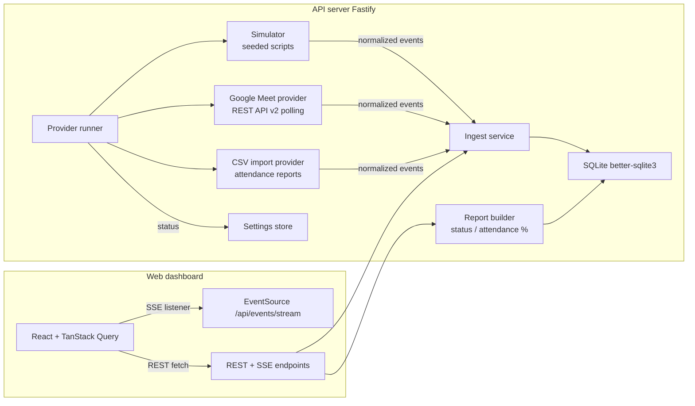

# MeetWatch

Monitors the status of online students in Google Meet sessions: who is online, who left, who
never joined, who was late — per class session, with live updates and attendance exports.

Built as a school system-integration project, MeetWatch is provider-agnostic: the same
dashboard works with **simulated data** (default, zero credentials), a **live Google Meet
call** (Meet REST API v2), or an **imported attendance report** (CSV).

## Quick start

```bash
pnpm install
pnpm dev
```

That starts:

- the **API** on http://localhost:4000 (Fastify + SQLite + SSE), and
- the **web dashboard** on http://localhost:5173 (Vite + React).

The default simulator seeds a 25-student roster and schedules a demo session that begins
about 30 seconds after boot. Student activity appears on the Dashboard in real time.

## The 3-minute demo

1. **Watch a live session.** On the Dashboard, the seeded session shows summary cards
   (online / left / absent / late), a searchable student table with attendance bars, an
   activity feed, and — if a Meet participant is not on the roster — the
   _Unknown participants_ panel for one-click manual mapping.
2. **Run a fresh demo.** Go to **Settings → Simulator → Start demo session**; a 45-minute
   simulated class plays at 20× (≈2 real minutes) and streams into the Dashboard.
3. **Look at the record.** Open **History**, pick an ended session, and check per-student
   attendance, the pass-mark summary, and **Export CSV**.
4. **Import a real report.** In **Settings → Attendance CSV import**, enter any meeting code
   and upload `docs/samples/meet-attendance-sample.csv` (first switch the provider to _CSV
   import_). The file becomes a completed session with attendance.
5. **Connect Google (optional).** With credentials configured
   (see [docs/GOOGLE_SETUP.md](docs/GOOGLE_SETUP.md)), connect an account and switch the
   provider to _Google Meet (live)_ to track a real meeting by its Meet code.

## Architecture



- **Domain logic is pure** (`apps/api/src/domain`): status computation, attendance
  percentages, late/unstable flags, and roster matching are plain functions with unit tests.
- **Every provider funnels through one ingest service**, which persists join/leave intervals
  and broadcasts SSE events — the dashboard neither knows nor cares which provider ran.
- **Live updates are SSE only** (no websockets): `activity`, `refresh`, `sessions`,
  `provider` events drive TanStack Query invalidations; durations tick client-side.

## Concepts

| Term                   | Meaning                                                                    |
| ---------------------- | -------------------------------------------------------------------------- |
| Session                | A scheduled class window with a Meet code; the unit being monitored        |
| Online / Left / Absent | Derived from join/leave intervals against the session window               |
| Late                   | First join more than `late_threshold_minutes` (default 10) after the start |
| Unstable connection    | 3 or more rejoins in one session                                           |
| Attendance %           | Time in call ÷ elapsed (or full) session duration, capped at 100%          |
| Mapping                | Persisted manual match between a Meet participant and a roster student     |

Matching order: exact email → stored mapping → fuzzy display-name match (Jaro-Winkler ≥ 0.90
with a shared token) → email local-part. Anything unmatched is surfaced for manual mapping
rather than guessed — see `docs/ASSUMPTIONS.md` for every interpretation decision.

## Providers

| Provider              | Use case                               | Needs                                                                         |
| --------------------- | -------------------------------------- | ----------------------------------------------------------------------------- |
| `simulator` (default) | Demos and development                  | Nothing                                                                       |
| `google`              | Live meetings via Meet REST API v2     | OAuth credentials — [docs/GOOGLE_SETUP.md](docs/GOOGLE_SETUP.md)              |
| `csv`                 | Import a Google Meet attendance report | The report CSV (see [docs/samples/](docs/samples/meet-attendance-sample.csv)) |

Switch providers at runtime from **Settings**; the runner records provider status (idle /
running / needs auth / error) and the UI surfaces it as a banner.

## Configuration (environment)

| Variable                                                            | Default                  | Purpose                                          |
| ------------------------------------------------------------------- | ------------------------ | ------------------------------------------------ |
| `PROVIDER`                                                          | `simulator`              | Provider started on boot                         |
| `PORT` / `HOST`                                                     | `4000` / `127.0.0.1`     | API bind address                                 |
| `WEB_ORIGIN`                                                        | `http://localhost:5173`  | CORS + OAuth redirect target                     |
| `DB_PATH`                                                           | `data/meetwatch.sqlite3` | SQLite file (gitignored)                         |
| `SIMULATOR_SPEED`                                                   | `20`                     | Sim minutes per wall minute for demo sessions    |
| `LATE_THRESHOLD_MINUTES`                                            | `10`                     | Default lateness threshold for new sessions      |
| `MIN_ATTENDANCE_PCT`                                                | `75`                     | Default pass mark for new sessions               |
| `MEET_POLL_INTERVAL_MS`                                             | `15000`                  | Google provider poll cadence                     |
| `GOOGLE_CLIENT_ID` / `GOOGLE_CLIENT_SECRET` / `GOOGLE_REDIRECT_URI` | —                        | See [docs/GOOGLE_SETUP.md](docs/GOOGLE_SETUP.md) |

## Development

| Command          | What it does                  |
| ---------------- | ----------------------------- |
| `pnpm dev`       | Run API + web in watch mode   |
| `pnpm build`     | Production build of both apps |
| `pnpm test`      | All Vitest suites (api + web) |
| `pnpm typecheck` | TypeScript project checks     |
| `pnpm lint`      | ESLint                        |
| `pnpm format`    | Prettier write                |
| `pnpm quality`   | typecheck + lint + test       |

Layout:

```
apps/api    Fastify API: domain, repositories (plain SQL), providers, SSE, migrations
apps/web    React dashboard: pages, components, query hooks, SSE wiring
docs/       Assumptions log, Google setup, sample attendance CSV
```

Notes:

- Delete `apps/api/data/` for a fresh demo boot (roster and demo sessions re-seed).
- Restart quirk: simulator sessions created before a restart replay their elapsed simulated
  time immediately (catch-up), so an old demo session may finish right after boot — start a
  new one from Settings.
- Known limitation: on Google, signed-in Workspace participants can appear as opaque user IDs
  (see [docs/GOOGLE_SETUP.md](docs/GOOGLE_SETUP.md)); map them once from the Unknown
  participants panel.
