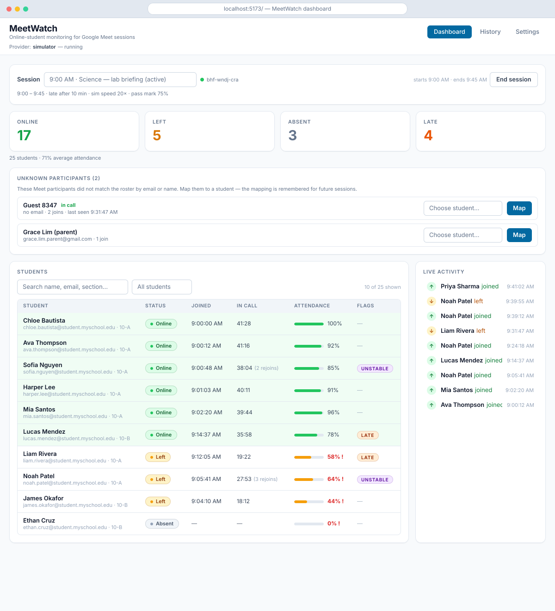
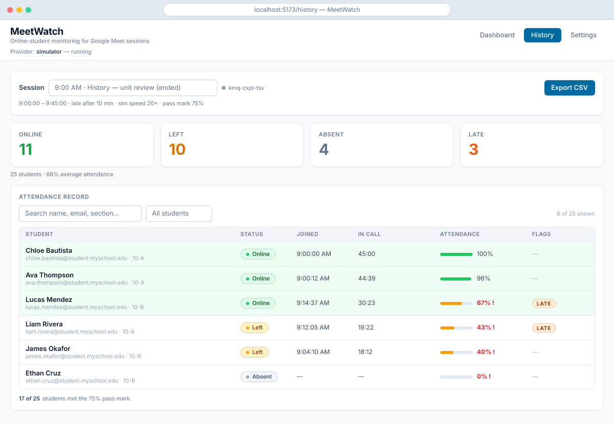
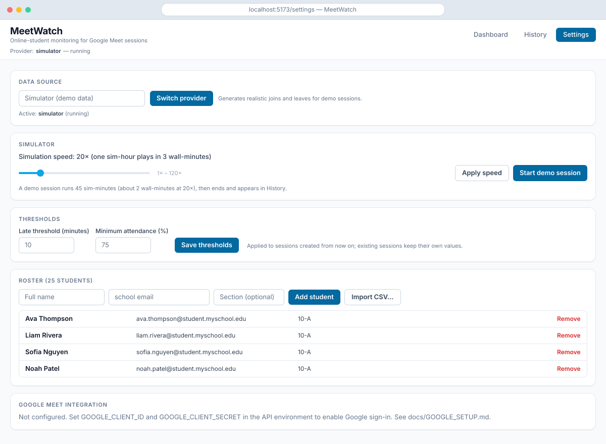
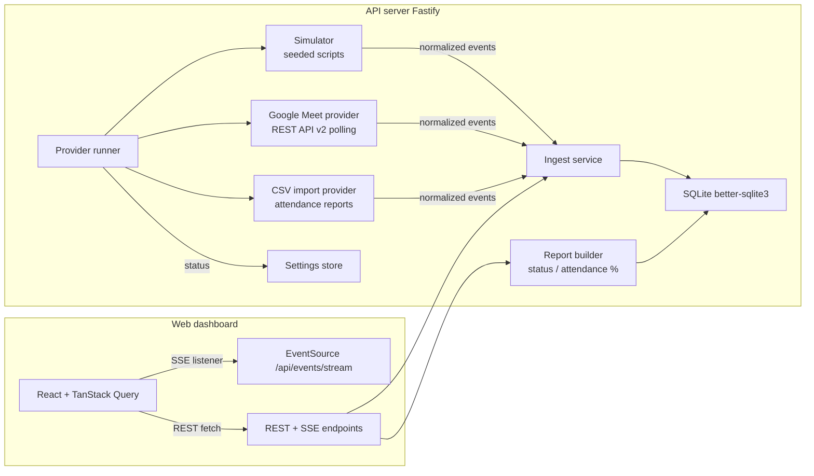

<div align="center">

  <picture>
    <source media="(prefers-color-scheme: dark)" srcset="docs/screenshots/banner-dark.svg" />
    
  </picture>

**Know who's in class.** MeetWatch tracks every student in a Google Meet session — who is
online, who left, who never joined, who was late — with live updates, attendance percentages,
and exportable records.

[](https://nodejs.org)
[](https://pnpm.io)
[](https://www.typescriptlang.org)
[](https://react.dev)
[](https://vite.dev)
[](https://tailwindcss.com)
[](https://tanstack.com/query)
[](https://fastify.dev)
[](https://sqlite.org)
[](https://zod.dev)
[](https://vitest.dev)


Built as a school **system-integration project**. Provider-agnostic by design: the same
dashboard runs on **simulated data** (default, zero credentials), a **live Google Meet
call** (Meet REST API v2), or an **imported attendance report** (CSV).

</div>

---

## 🖥️ See it in action

**Dashboard** — a live session: summary cards, searchable roster with attendance bars,
late/unstable flags, unknown-participant mapping, and the activity feed.

<picture>
  <source media="(prefers-color-scheme: dark)" srcset="docs/screenshots/dashboard-dark.svg" />
  
</picture>

**History** — any ended session, with per-student attendance and the pass-mark summary.

<picture>
  <source media="(prefers-color-scheme: dark)" srcset="docs/screenshots/history-dark.svg" />
  
</picture>

**Settings** — provider switching, the demo simulator, thresholds, roster, and CSV import.

<picture>
  <source media="(prefers-color-scheme: dark)" srcset="docs/screenshots/settings-dark.svg" />
  
</picture>

> These previews are vector renders generated from the real domain data model — run
> `pnpm previews` to regenerate them after UI changes. No screenshots involved.

## ✨ Features

- 📡 **Live monitoring** — join/leave activity streams over SSE; in-call durations tick per second.
- 🟢🟠 **Status at a glance** — online / left / absent / late summary cards for the running session.
- 📊 **Attendance %** — time in call ÷ session time per student, with pass-mark bars and fail markers.
- 🚩 **Late & unstable flags** — first join after the threshold, or 3+ rejoins, is flagged per student.
- 🧩 **Unknown-participant mapping** — Meet guests that don't match the roster are surfaced for
  one-click mapping; the mapping is remembered for future sessions.
- 📤 **CSV export** of any session record, and 📥 **CSV import** of real Google Meet attendance reports.
- 🔐 **Live Google Meet tracking** via the Meet REST API v2 with OAuth (optional).
- 🎛️ **Built-in simulator** — realistic demo sessions at adjustable speed; zero credentials needed.
- 🌓 **Light & dark themes** — the UI follows your system preference automatically.

## 🚀 Quick start

```bash
pnpm install
pnpm dev
```

That starts:

- the **API** on http://localhost:4000 (Fastify + SQLite + SSE), and
- the **web dashboard** on http://localhost:5173 (Vite + React).

The default simulator seeds a 25-student roster and schedules a demo session that begins
about 30 seconds after boot. Student activity appears on the Dashboard in real time.

## 🎬 The 3-minute demo

1. **Watch a live session.** On the Dashboard, the seeded session shows summary cards
   (online / left / absent / late), a searchable student table with attendance bars, an
   activity feed, and — if a Meet participant is not on the roster — the
   _Unknown participants_ panel for one-click manual mapping.
2. **Run a fresh demo.** Go to **Settings → Simulator → Start demo session**; a 45-minute
   simulated class plays at 20× (≈2 real minutes) and streams into the Dashboard.
3. **Look at the record.** Open **History**, pick an ended session, and check per-student
   attendance, the pass-mark summary, and **Export CSV**.
4. **Import a real report.** In **Settings → Attendance CSV import**, enter any meeting code
   and upload `docs/samples/meet-attendance-sample.csv` (first switch the provider to _CSV
   import_). The file becomes a completed session with attendance.
5. **Connect Google (optional).** With credentials configured
   (see [docs/GOOGLE_SETUP.md](docs/GOOGLE_SETUP.md)), connect an account and switch the
   provider to _Google Meet (live)_ to track a real meeting by its Meet code.

## 🧭 Architecture



- **Domain logic is pure** (`apps/api/src/domain`): status computation, attendance
  percentages, late/unstable flags, and roster matching are plain functions with unit tests.
- **Every provider funnels through one ingest service**, which persists join/leave intervals
  and broadcasts SSE events — the dashboard neither knows nor cares which provider ran.
- **Live updates are SSE only** (no websockets): `activity`, `refresh`, `sessions`,
  `provider` events drive TanStack Query invalidations; durations tick client-side.

## 📖 Concepts

| Term                   | Meaning                                                                    |
| ---------------------- | -------------------------------------------------------------------------- |
| Session                | A scheduled class window with a Meet code; the unit being monitored        |
| Online / Left / Absent | Derived from join/leave intervals against the session window               |
| Late                   | First join more than `late_threshold_minutes` (default 10) after the start |
| Unstable connection    | 3 or more rejoins in one session                                           |
| Attendance %           | Time in call ÷ elapsed (or full) session duration, capped at 100%          |
| Mapping                | Persisted manual match between a Meet participant and a roster student     |

Matching order: exact email → stored mapping → fuzzy display-name match (Jaro-Winkler ≥ 0.90
with a shared token) → email local-part. Anything unmatched is surfaced for manual mapping
rather than guessed — see `docs/ASSUMPTIONS.md` for every interpretation decision.

## 🔌 Providers

| Provider              | Use case                               | Needs                                                                         |
| --------------------- | -------------------------------------- | ----------------------------------------------------------------------------- |
| `simulator` (default) | Demos and development                  | Nothing                                                                       |
| `google`              | Live meetings via Meet REST API v2     | OAuth credentials — [docs/GOOGLE_SETUP.md](docs/GOOGLE_SETUP.md)              |
| `csv`                 | Import a Google Meet attendance report | The report CSV (see [docs/samples/](docs/samples/meet-attendance-sample.csv)) |

Switch providers at runtime from **Settings**; the runner records provider status (idle /
running / needs auth / error) and the UI surfaces it as a banner.

## ⚙️ Configuration (environment)

| Variable                                                            | Default                  | Purpose                                          |
| ------------------------------------------------------------------- | ------------------------ | ------------------------------------------------ |
| `PROVIDER`                                                          | `simulator`              | Provider started on boot                         |
| `PORT` / `HOST`                                                     | `4000` / `127.0.0.1`     | API bind address                                 |
| `WEB_ORIGIN`                                                        | `http://localhost:5173`  | CORS + OAuth redirect target                     |
| `DB_PATH`                                                           | `data/meetwatch.sqlite3` | SQLite file (gitignored)                         |
| `SIMULATOR_SPEED`                                                   | `20`                     | Sim minutes per wall minute for demo sessions    |
| `LATE_THRESHOLD_MINUTES`                                            | `10`                     | Default lateness threshold for new sessions      |
| `MIN_ATTENDANCE_PCT`                                                | `75`                     | Default pass mark for new sessions               |
| `MEET_POLL_INTERVAL_MS`                                             | `15000`                  | Google provider poll cadence                     |
| `GOOGLE_CLIENT_ID` / `GOOGLE_CLIENT_SECRET` / `GOOGLE_REDIRECT_URI` | —                        | See [docs/GOOGLE_SETUP.md](docs/GOOGLE_SETUP.md) |

## 🛠️ Development

| Command          | What it does                            |
| ---------------- | --------------------------------------- |
| `pnpm dev`       | Run API + web in watch mode             |
| `pnpm build`     | Production build of both apps           |
| `pnpm test`      | All Vitest suites (api + web)           |
| `pnpm typecheck` | TypeScript project checks               |
| `pnpm lint`      | ESLint                                  |
| `pnpm format`    | Prettier write                          |
| `pnpm quality`   | typecheck + lint + test                 |
| `pnpm previews`  | Regenerate the README UI previews (SVG) |

Layout:

```
apps/api         Fastify API: domain, repositories (plain SQL), providers, SSE, migrations
apps/web         React dashboard: pages, components, query hooks, SSE wiring
apps/web/scripts Preview generator: JSX + satori renders docs/screenshots/*.svg
docs/            Assumptions log, Google setup, sample attendance CSV, generated previews
```

## 📚 Documentation

- [docs/GOOGLE_SETUP.md](docs/GOOGLE_SETUP.md) — enabling the live Google Meet provider
  (OAuth consent, scopes, refresh-token storage and security notes).
- [docs/ASSUMPTIONS.md](docs/ASSUMPTIONS.md) — every interpretation decision the project
  makes, with reasons.
- [docs/samples/meet-attendance-sample.csv](docs/samples/meet-attendance-sample.csv) — a
  real-shaped attendance report for the CSV import demo.

## ⚠️ Notes & known limitations

- Delete `apps/api/data/` for a fresh demo boot (roster and demo sessions re-seed).
- Restart quirk: simulator sessions created before a restart replay their elapsed simulated
  time immediately (catch-up), so an old demo session may finish right after boot — start a
  new one from Settings.
- On Google, signed-in Workspace participants can appear as opaque user IDs (see
  [docs/GOOGLE_SETUP.md](docs/GOOGLE_SETUP.md)); map them once from the Unknown participants
  panel.
